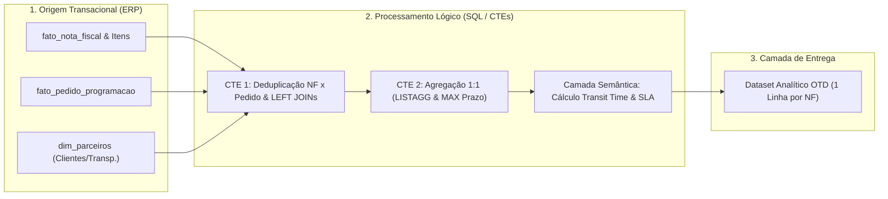

# Monitoramento de Performance Logística e SLA de Entregas (OTD)

## 📌 O Desafio de Negócio (Contexto)
A operação logística enfrentava baixa visibilidade sobre o desempenho das transportadoras e o cumprimento dos prazos acordados com os clientes (*On-Time Delivery* - OTD). O relatório operacional legado apresentava três gargalos críticos:
* **Distorção de Granularidade:** Notas fiscais com múltiplos itens ou múltiplos pedidos multiplicavam linhas, inflando artificialmente o volume de entregas na análise gerencial.
* **Perda de Rastreabilidade:** Faturamentos avulsos (remessas, amostras) ou retiradas sem transportadora vinculada eram ocultados por junções restritivas (`INNER JOIN`).
* **Ausência de Indicadores de SLA:** Não havia distinção automática entre entregas concluídas (no prazo, adiantadas ou atrasadas) e entregas ainda em trânsito aguardando baixa de comprovante.

## 🎯 O Objetivo
* Consolidar a visão analítica no grão exato de **1 linha por Nota Fiscal**, agrupando múltiplos pedidos vinculados sem duplicidade.
* Incorporar a identificação da transportadora e a decodificação fiscal da modalidade de frete (`CIF`, `FOB`, `RTR`, `SEM`).
* Calcular o *Transit Time* real (emissão até entrega) e o saldo de dias em aberto para comprovantes pendentes.
* Classificar automaticamente cada entrega em categorias de SLA (*No Prazo*, *Adiantada*, *Atrasada* ou *Pendente*).

## 📐 Arquitetura do Fluxo de Dados

## 🛠️ A Solução Técnica

* **Modelagem em Cascata com CTEs (WITH):** Separação clara entre deduplicação de pedidos (cte_notas_pedidos_dedup), consolidação no grão da nota (cte_notas_consolidadas) e aplicação de regras de negócio.

* **Compatibilidade e Deduplicação Segura:** Pré-agrupamento antes do LISTAGG para eliminar números de pedidos repetidos sem depender de recursos exclusivos de versões mais recentes do SGBD (prevenindo erros de sintaxe como ORA-30482).

* **Preservação de Integridade (LEFT JOIN):** Garante 100% de cobertura das notas emitidas no período, tratando valores nulos com NVL e CASE sem comprometer o uso de índices.

* **Normalização Temporal (TRUNC):** Remoção do componente de hora/minuto antes da subtração de datas para evitar distorções de ±1 dia nos cálculos de Transit Time e desvio de prazo.

## 🚀 Impacto Esperado

* **Governança e Precisão de KPIs:** Eliminação total de duplicidades na contagem de notas faturadas, entregando uma base confiável para apuração mensal de OTD por transportadora e modalidade de frete.

* **Gestão Preventiva de Atrasos:** Separação explícita entre atrasos confirmados (com comprovante) e pendências vencidas em trânsito (Pendente (Em Atraso)), permitindo atuação proativa da equipe logística antes da reclamação do cliente.

* **Alta Performance Transacional:** Execução leve baseada em chaves primárias e estrangeiras, sem subqueries correlacionadas linha a linha.
